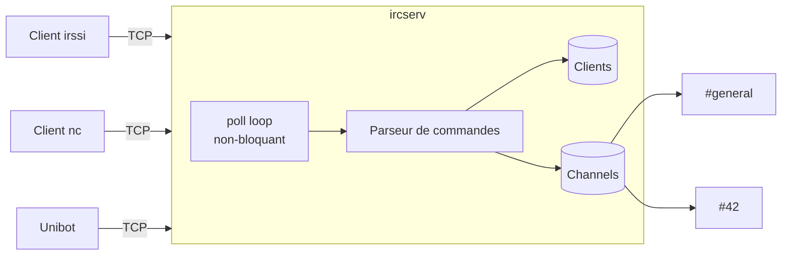

# ft_irc

**Un serveur IRC en C++98**, conforme au protocole (RFC 1459/2812) : plusieurs
clients simultanés sur une seule socket non bloquante (`poll`), canaux,
opérateurs, modes — et un bot en bonus. Projet du tronc commun de l'École 42.


Compatible avec un vrai client IRC (testé avec `irssi` / `nc`).

## Architecture



Un seul thread, une boucle `poll()` : le serveur multiplexe toutes les
connexions sans bloquer, lit les commandes ligne par ligne et met à jour l'état
des clients et des canaux.

## Commandes supportées

`PASS` · `NICK` · `USER` · `JOIN` · `PART` · `PRIVMSG` · `NOTICE` · `KICK` ·
`INVITE` · `TOPIC` · `MODE` (`+i`, `+t`, `+k`, `+o`, `+l`) · `QUIT` · `PING` /
`PONG`.

## Build & lancement

```bash
make                 # compile -> ./ircserv
./ircserv <port> <password>
```

Connexion depuis un client :

```bash
irssi -c 127.0.0.1 -p 6667 -w <password>
# ou, brut :
nc 127.0.0.1 6667
```

### Bonus — Unibot

```bash
make bonus           # compile le bot
./Unibot^_^ <port> <password>
```

## Structure

```
main.cpp        point d'entrée, parsing des arguments
Server.*        boucle poll(), gestion des sockets et de l'état global
Client.*        état d'un client (nick, auth, buffers)
Channel.*       canal : membres, opérateurs, modes, topic
Command.*       dispatch et implémentation des commandes IRC
IrcCodes.hpp    codes de réponse numériques (RPL_/ERR_)
Unibot.*        bot IRC (bonus)
```

Compilé en `c++ -std=c++98 -Wall -Wextra -Werror` (norme 42).

## Licence

MIT — voir [LICENSE](LICENSE).
